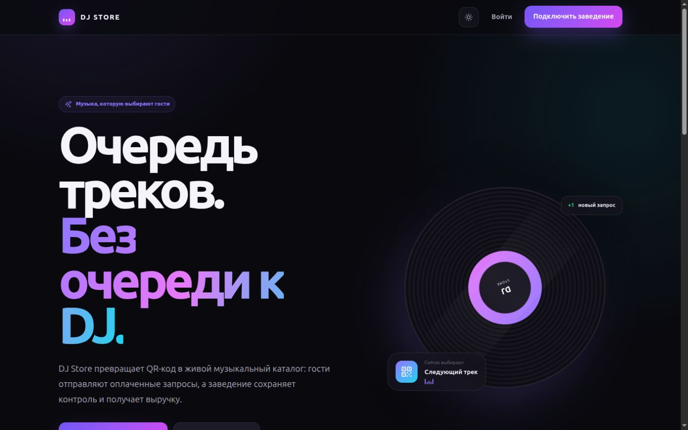
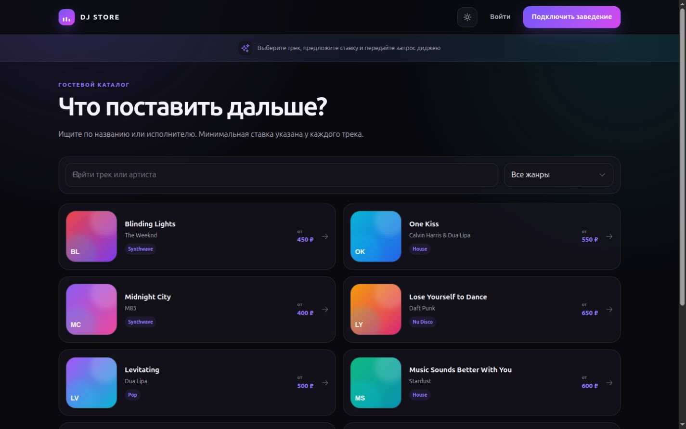
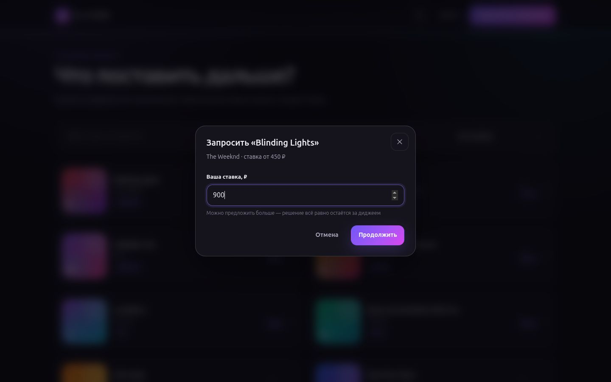
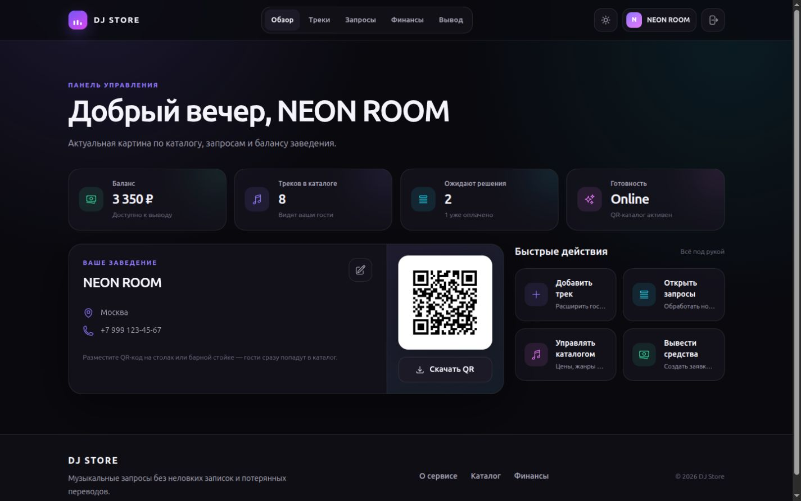
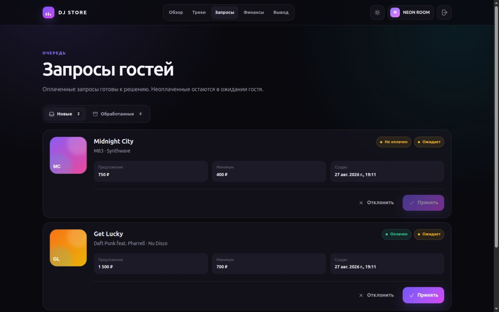
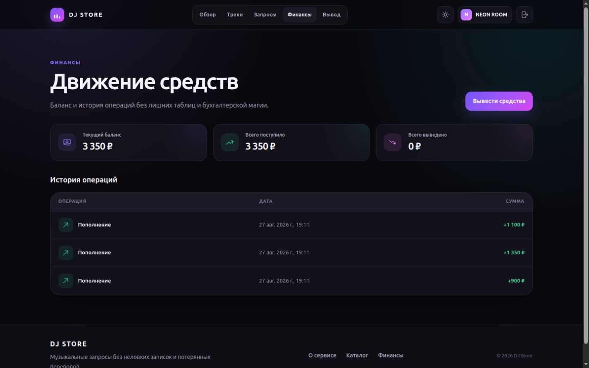
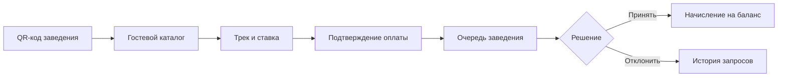

<div align="center">
  
  <h1>DJ Store</h1>
  <p>
    <strong>Музыкальные запросы без очереди к диджею.</strong><br>
    Гость выбирает трек по QR-коду, предлагает ставку и оплачивает запрос — заведение управляет очередью и выручкой из одного кабинета.
  </p>
  <p>
    
    
    
    
    
    
  </p>
</div>



<table>
  <tr>
    <td width="50%">
      
      <br><sub><b>Гостевой каталог.</b> Поиск, жанры и минимальная ставка доступны без регистрации.</sub>
    </td>
    <td width="50%">
      
      <br><sub><b>Заказ трека.</b> Гость выбирает сумму и отправляет запрос за несколько секунд.</sub>
    </td>
  </tr>
  <tr>
    <td width="50%">
      
      <br><sub><b>Панель управления.</b> Баланс, QR-код, каталог и очередь в одном месте.</sub>
    </td>
    <td width="50%">
      
      <br><sub><b>Очередь запросов.</b> Статус оплаты и решение по каждому треку видны сразу.</sub>
    </td>
  </tr>
  <tr>
    <td colspan="2">
      
      <br><sub><b>Финансы.</b> Актуальный баланс и прозрачная история всех операций.</sub>
    </td>
  </tr>
</table>

## Содержание

- [О проекте](#о-проекте)
- [Возможности](#возможности)
- [Как работает запрос](#как-работает-запрос)
- [Технологии](#технологии)
- [Архитектура](#архитектура)
- [Быстрый старт](#быстрый-старт)
- [Конфигурация](#конфигурация)
- [Команды и проверки](#команды-и-проверки)
- [Документация](#документация)

## О проекте

DJ Store связывает гостя, диджея и заведение одним коротким сценарием. После сканирования QR-кода гость попадает в публичный каталог, выбирает композицию, предлагает ставку и подтверждает оплату. Владелец заведения видит запрос в очереди, принимает или отклоняет его и контролирует начисления.

Приложение включает два независимых TypeScript-проекта:

- `client` — адаптивный Vue SPA с FSD-архитектурой, Pinia и общим UI-kit;
- `server` — Express API с Drizzle ORM, Zod-валидацией, JWT и SQLite.

## Возможности

### Для гостя

- публичный музыкальный каталог по QR-ссылке;
- поиск по названию и исполнителю, фильтрация по жанру;
- понятная минимальная ставка и возможность предложить больше;
- создание запроса без регистрации;
- отдельный безопасный сценарий подтверждения оплаты.

### Для заведения

- регистрация профиля и автоматически создаваемый QR-код;
- управление треками, жанрами, ценами и обложками;
- очередь новых и обработанных запросов;
- различимые статусы оплаты, принятия и отклонения;
- баланс, история транзакций и заявки на вывод;
- светлая и тёмная темы, адаптивная навигация и состояния ошибок.

## Как работает запрос



## Технологии

| Область | Технологии |
| --- | --- |
| Frontend | Vue 3, TypeScript, Vite, Pinia, Vue Router, Tailwind CSS |
| Архитектура UI | Feature-Sliced Design, переиспользуемый UI-kit, lazy-loaded страницы |
| Backend | Node.js, Express.js 5, TypeScript |
| Данные | SQLite, Drizzle ORM, SQL-миграции |
| Валидация | Zod на HTTP-параметрах, query и телах запросов |
| Авторизация | JWT access/refresh tokens, хеширование паролей |
| Платежи | Локальные mock-сценарии и интеграция с ЮKassa |
| Качество | ESLint, vue-tsc, Vitest, Supertest, production build |

## Архитектура

Frontend организован по принципу направленных зависимостей: страницы собираются из виджетов и пользовательских сценариев, сценарии работают с бизнес-сущностями, а общая инфраструктура остаётся в `shared`.

```text
djstore/
├── client/
│   ├── public/                 статические ресурсы
│   └── src/
│       ├── app/                bootstrap, router, глобальные стили
│       ├── pages/              страницы маршрутов
│       ├── widgets/            крупные композиционные блоки
│       ├── features/           формы и пользовательские действия
│       ├── entities/           модели, API и UI бизнес-сущностей
│       └── shared/             HTTP-клиент, конфигурация, утилиты, UI-kit
├── server/
│   ├── drizzle/                SQL-миграции
│   ├── media/                  QR-коды и медиафайлы
│   ├── src/
│   │   ├── db/                 Drizzle-схема и подключение к SQLite
│   │   ├── http/               Express routes, middleware, Zod-схемы
│   │   ├── lib/                JWT, пароли, ошибки и форматирование
│   │   └── services/           платёжные интеграции
│   └── tests/                  интеграционные API-тесты
└── docs/screenshots/           галерея интерфейса
```

## Быстрый старт

### Требования

- Node.js 22 или новее;
- npm 10 или новее.

### 1. Backend

```bash
cd server
cp .env.example .env
npm install
npm run db:migrate
npm run dev
```

API запустится на `http://localhost:8000`. Проверка состояния:

```bash
curl http://localhost:8000/health/
```

### 2. Frontend

В отдельном терминале:

```bash
cd client
cp .env.example .env
npm install
npm run dev
```

Приложение будет доступно на `http://localhost:3000`.

> [!NOTE]
> Репозиторий содержит совместимую SQLite-базу `server/db.sqlite3`. Миграции сохраняют существующие данные. Для чистой базы укажите новый путь в `DATABASE_URL` перед запуском `npm run db:migrate`.

## Конфигурация

Минимальная конфигурация frontend:

| Переменная | Назначение | Значение по умолчанию |
| --- | --- | --- |
| `VITE_API_URL` | Base URL REST API | `http://127.0.0.1:8000/api/` |

Основные переменные backend:

| Переменная | Назначение | Значение по умолчанию |
| --- | --- | --- |
| `PORT` | HTTP-порт | `8000` |
| `DATABASE_URL` | Путь к SQLite | `./db.sqlite3` |
| `CLIENT_URL` | URL frontend и разрешённый CORS origin | `http://localhost:3000` |
| `DOMAIN` | Публичный URL backend | `http://localhost:8000` |
| `JWT_SECRET` | Ключ подписи JWT | только для локальной разработки |
| `MEDIA_ROOT` | Каталог QR-кодов и медиа | `./media` |
| `MIN_WITHDRAWAL_AMOUNT` | Минимальная сумма вывода | `500` |
| `WITHDRAWAL_FEE_PERCENT` | Комиссия за вывод | `0.05` |

> [!IMPORTANT]
> Для production обязательно задайте собственный `JWT_SECRET`, публичные `CLIENT_URL` и `DOMAIN`, а также храните платёжные секреты только в переменных окружения.

## Команды и проверки

### Frontend

| Команда | Назначение |
| --- | --- |
| `npm run dev` | локальная разработка с HMR |
| `npm run type-check` | проверка Vue и TypeScript |
| `npm run lint` | статический анализ ESLint |
| `npm run build-only` | production-сборка Vite |
| `npm run check` | type-check, lint и build одной командой |
| `npm run preview` | локальный просмотр production-сборки |

### Backend

| Команда | Назначение |
| --- | --- |
| `npm run dev` | разработка с автоматическим перезапуском |
| `npm run db:migrate` | применение SQL-миграций |
| `npm run type-check` | проверка TypeScript |
| `npm test` | интеграционные API-тесты |
| `npm run build` | сборка в `dist/` |
| `npm start` | запуск собранного API |

Полная проверка проекта:

```bash
cd client && npm run check
cd ../server && npm run type-check && npm test && npm run build
```

## Документация

- [`client/README.md`](./client/README.md) — запуск frontend и описание FSD-слоёв;
- [`server/README.md`](./server/README.md) — переменные окружения и таблица REST API;
- [`server/.env.example`](./server/.env.example) — пример backend-конфигурации;
- [`client/.env.example`](./client/.env.example) — пример frontend-конфигурации.
